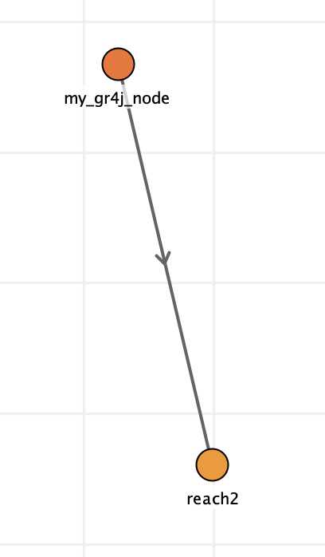

# About Kalix

Kalix is a hydrologic modelling platform for catchment and river simulation. It is focussed on core performance and technical usability, and it is free and open source.

## What it offers

<div class="kx-cards" markdown>
<div class="kx-card-item" markdown>
#### Free forever
An open-source licence ([MPL 2.0](https://www.mozilla.org/en-US/MPL/2.0/)) keeps it available and free.
</div>
<div class="kx-card-item" markdown>
#### Fast simulation
Simulation time is benchmarked as the engine changes; see the [speed plot](../code/index.md#latest-stats).
</div>
<div class="kx-card-item" markdown>
#### Any platform
Runs on Linux, Mac and Windows.
</div>
<div class="kx-card-item" markdown>
#### Plain-text models
A [text-based model file](model-file-structure.md) you can read, diff and version.
</div>
<div class="kx-card-item" markdown>
#### Proven hydrology
Established rainfall-runoff models such as [Sacramento](sacramento.md), [GR4J](gr4j.md) and [AWBM](awbm.md).
</div>
<div class="kx-card-item" markdown>
#### Calibration
[Optimisation](optimisation.md) with established algorithms: [DE](differential-evolution.md), [SCE](sce.md), [CMA-ES](cma-es.md) and [DREAM](dream.md).
</div>
<div class="kx-card-item" markdown>
#### Water management
[Ordering](ordering.md), [storages](storage.md), users and [allocation](allocation-systems.md) for regulated rivers.
</div>
<div class="kx-card-item" markdown>
#### CLI and IDE
A commandline application ([Kalix CLI](cli.md)) and a desktop application ([Kalix IDE](ide.md)).
</div>
<div class="kx-card-item" markdown>
#### Run management
Compare runs and observed data in the [Run Manager](ide.md#run-manager).
</div>
<div class="kx-card-item" markdown>
#### Python bindings
A [Python package](python.md) for data-science workflows.
</div>
<div class="kx-card-item" markdown>
#### AI-friendly
Interfaces that suit AI-supported model development.
</div>
</div>

## How a model is built

Kalix models conceptualise river systems as a network of nodes and links. The model steps on a constant timestep, typically daily but configurable.

<div class="kx-cards" markdown>
<div class="kx-card-item" markdown>
#### Nodes
Active elements that represent lumped river processes, modifying the flow of water through the network.
</div>
<div class="kx-card-item" markdown>
#### Links
Passive elements that define the connection between nodes and pass water from one node to the next.
</div>
</div>

## Where to get it

### For modellers

<div class="kx-cards" markdown>
<div class="kx-card-item" markdown>
#### Executables
On the [Downloads](../downloads.md) page.
</div>
<div class="kx-card-item" markdown>
#### Homepage
[kalix.org](https://kalix.org)
</div>
<div class="kx-card-item" markdown>
#### Licence
[Mozilla Public License 2.0](https://www.mozilla.org/en-US/MPL/2.0/)
</div>
</div>

### For developers

<div class="kx-cards" markdown>
<div class="kx-card-item" markdown>
#### Getting started
[Getting started](https://github.com/chasegan/Kalix/wiki/Getting-started) on the GitHub wiki.
</div>
<div class="kx-card-item" markdown>
#### Source code
[github.com/chasegan/Kalix](https://github.com/chasegan/Kalix)
</div>
<div class="kx-card-item" markdown>
#### Task management
The [project board](https://github.com/users/chasegan/projects/1/views/2) on GitHub.
</div>
<div class="kx-card-item" markdown>
#### Dev notes
The [GitHub wiki](https://github.com/chasegan/Kalix/wiki).
</div>
</div>

## Quick example

A GR4J catchment draining to a routing reach:

```ini
[kalix]

[data]
./data/rex_mpot.csv
./data/rex_rain.csv

[node.my_gr4j_node]
type = gr4j
loc = -186.86, 316.11
area = 22.8
rain = data.rex_rain_csv.by_name.value
evap = data.rex_mpot_csv.by_name.value
params = 1999.996, 5.9991, 65.224, 0.380800
ds_1 = reach2

[node.reach2]
type = routing
loc = -150.24, 469.70
lag = 2

[outputs]
node.my_gr4j_node.dsflow
node.reach2.volume
node.reach2.dsflow
```

<figure markdown>

<figcaption>The example model on the Kalix IDE schematic: my_gr4j_node flows to reach2.</figcaption>
</figure>
