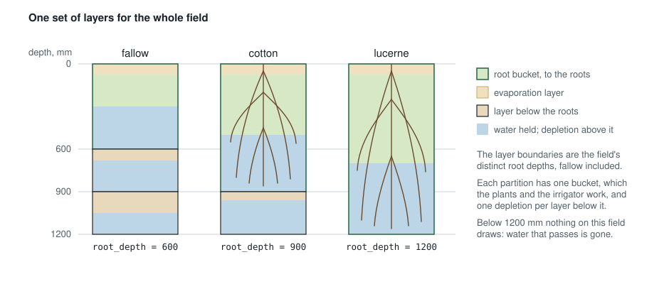
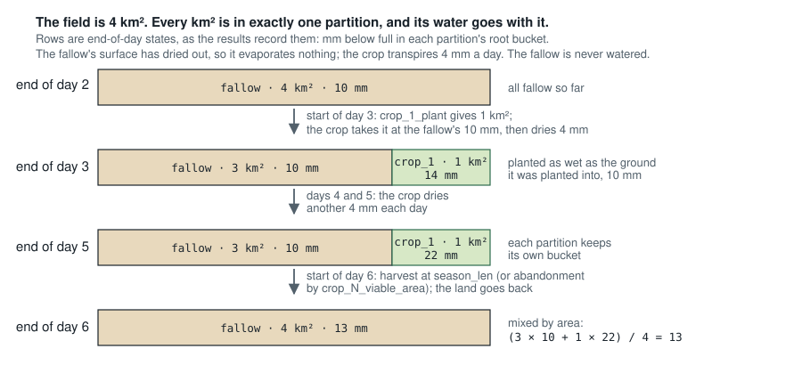

# Field

## At a glance…

The field node represents an irrigated field: paddocks under crops on a soil that dries by
evapotranspiration, fills with rain and irrigation, and orders water upstream to meet each crop's
deficit. Each crop's root zone is the FAO-56 daily depletion balance, with the crop's coefficient
and a stress coefficient that reduces evapotranspiration as the soil dries. The soil below the
roots is kept in layers, so that water left by one crop is there for the next.

The field follows FAO-56 for the soil and the crop, pyfao56 for the soil below the roots, and
Source's Irrigator Demand Model for the farm: the fallow, planting, the irrigation target, crop
death and losses. [Where each part comes from](#where-each-part-comes-from) says which rule is
whose, and what is Kalix's own.

A field is supplied by the node above it: a [storage](storage.md) outlet, or a supply outlet
(`ds_2` to `ds_4`) of a [regulated user](regulated-user.md#supply-outlets) or an
[unregulated user](unregulated-user.md#supply-outlets). What it does not take, and what runs off
the soil, drains down `ds_1`; the share of the runoff the farm catches leaves on `ds_2` instead.

The field has a **fallow**, which is what is not planted, and up to four **crop slots**. A crop
is declared once, in a `[crop.*]` section: what is true of the plant wherever it grows. A slot's
properties are the farmer's decisions for that crop: when to plant, how much, how to irrigate,
when to abandon it. Planting takes area from the fallow; harvest gives it back.

```ini
[crop.cotton]
root_depth = 1200                   # mm, fully grown
initial_root_depth = 250            # mm at planting
p = 0.6
kcb = Day, Kcb,                     # basal coefficient by days since planting
      0,   0.15,
      30,  0.15,
      80,  1.10,
      140, 1.10,
      180, 0.40,
season_len = 180                    # harvested this many days after planting

[crop.bare_soil]
root_depth = 600
kcb = 0                             # bare soil: the surface layer evaporates

[node.paddock]
type = field
loc = 30, 40
area = 4.2                          # km2
available_water = 165               # mm of water per m of soil: a Vertosol
rain = data.climate_csv.by_name.rain
evap = data.climate_csv.by_name.et0
efficiency = 0.7                    # net of tailwater returns
interception = 0                    # the surface layer evaporates small rains itself
tew = 28                            # mm the surface layer can evaporate (FAO-56 Table 19)
rew = 8                             # mm of it at the full rate
kc_max = 1.25                       # a hot, dry summer (FAO-56 equation 72)
fallow = bare_soil
crop_1 = cotton
crop_1_plant = if(sim.month == 10 && sim.day == 15, min(this.area, 0.01 * node.ofs.volume[-1, 0] / 8), 0)
crop_1_order = this.crop_1_area * clamp(this.crop_1_depletion[-1, 0] - 40, 0, 120) / this.efficiency - this.crop_1_orders_en_route[-1, 0]
ds_1 = drain
```

## Crops: `[crop.*]`

A crop is a section in the `crop.*` namespace, referenced by name from any number of fields. It
is a declaration: numbers and one table, nothing evaluated. The name is lowercase letters,
digits and underscores, starting with a letter.

| Property | Description |
| --- | --- |
| root\_depth (compulsory) | How deep the crop roots when fully grown [mm]. Its bucket holds `available_water × root_depth / 1000` mm of water between full and empty. Example: `root_depth = 900` |
| initial\_root\_depth (optional) | How deep the roots are at planting [mm]. They grow to `root_depth` as the crop's `kcb` rises from its first value to its peak, in step with it, as FAO-56 and pyfao56 grow them; the soil they grow into joins the bucket with the water it holds. Needs a `kcb` table that rises. Omitted, the roots are at `root_depth` from the day of planting, as Source's Irrigator has them. Example: `initial_root_depth = 200` |
| p (optional) | The depletion fraction: the share of the bucket the crop can use before stress begins, for a crop using about 5 mm/day (FAO-56 Table 22). Default 0.5. Example: `p = 0.65` |
| p\_adjust (optional) | Whether `p` is adjusted each day for the crop's evapotranspiration, as FAO-56's Table 22 says to and pyfao56 does: `p + 0.04 × (5 − (kcb × kc_multiplier + ke) × evap)`, held between 0.1 and 0.8, or between `p` and that range when `p` is written outside it. Default true. Write `false` to use `p` as written, as Source's Irrigator does. Example: `p_adjust = false` |
| kcb (compulsory) | The basal crop coefficient (FAO-56 Table 17): the crop's transpiration alone, as a number or a table of (days since planting, kcb) with the FAO-56 curve as its rows, interpolated between rows and held flat beyond the first and last. A text header row is allowed. The soil surface evaporates separately, from the field's evaporation layer (`tew`, `rew`), by a coefficient `ke` the node works out each day from how wet the surface is and how much ground the canopy leaves bare; see [The basal coefficient](#the-basal-coefficient). A single coefficient `kc` is refused: see [Coming from a single coefficient](#coming-from-a-single-coefficient). Example: `kcb = 0, 0.15, 80, 1.10, 140, 1.10, 180, 0.40` |
| season\_len (optional) | Days from planting to harvest. Omitted, the crop is a perennial and is never harvested. Example: `season_len = 180` |

Every field has a fallow: a crop with no plants, declared like any other and named by the field's
`fallow`. It is never irrigated and never planted; it receives area at harvest and abandonment
and gives it up at planting. A field with no crop slots is all fallow, all the time. Bare
ground is `kcb = 0`: FAO-56's bare soil, which evaporates from the field's evaporation layer at
`kc_max × evap` while less than `rew` has gone, then at a falling rate to nothing at `tew`,
exactly as Chapter 7 has it. Its `root_depth` is only the depth of soil the fallow's bucket
covers, 600 mm say, which sets how much water it holds for the next crop. A fallow with a cover
crop or stubble has a small `kcb` instead. Source Irrigator's fallow factor converts as
[Coming from a single coefficient](#coming-from-a-single-coefficient) says.

## Coming from a single coefficient

Every published crop table a modeller is likely to have is a single coefficient Kc: FAO-56
Table 12, WATERpak, the NSW river-system model reports, IQQM and Source Irrigator all think in
Kc. The field takes the basal coefficient `kcb`, which is the plant's transpiration alone, and
computes the soil surface's evaporation itself. FAO-56 derived both tables from the same field
data and states the relationship between them (Chapter 7), so a Kc table converts in three
edits:

| Stage | Rule | Why |
| --- | --- | --- |
| Initial | `kcb` = 0.15, whatever Kc ini was | Kc ini is almost all soil evaporation: FAO-56 Figure 29 makes it a function of how often the surface is wetted, not of the crop. The evaporation layer now computes it from the actual rain and irrigation. |
| Mid-season | `kcb` = Kc mid − 0.05 | Under a full canopy the surface is shaded and the plant does nearly all the work. Sparse canopies, − 0.10. |
| End | `kcb` = Kc end − 0.05 to − 0.10 | The canopy thins and the surface shows again; the larger gap for crops that dry down in the field. |
| Stage lengths | unchanged | The same Table 11 days. |

Applied to the cotton factors the NSW Border Rivers and Namoi models use, 0.35, 1.20 and 0.60,
the rule gives 0.15, 1.15 and 0.50, which is FAO-56 Table 17's own cotton row. Do not write a
Kc table as `kcb`: Kc ini already contains the bare-soil evaporation that `ke` would then add
again, and the initial stage would run too wet.

The fallow converts by rule too. Source Irrigator's fallow factor of 0.4 to 0.6 on a 300 to
600 mm bucket becomes `kcb = 0` with the field's `tew` and `rew`: FAO-56's bare soil, which
evaporates at `kc_max × evap` while the surface is wet and at a falling rate as it dries. The
bucket depth then only sets how much water the fallow holds for the next crop. An interception
deduction is no longer needed, because the layer evaporates small rains itself, so leave
`interception` at its default of 0.

The seasonal totals agree. Kc was averaged over a typical wetting frequency; the dual
coefficient gives the same season when the surface is wetted that often, and differs day by
day in the direction the surface says: more evapotranspiration after rain or irrigation, less
in a dry spell. A model that calibrates to diversions keeps doing so through
`crop_N_kc_multiplier`, which scales `kcb` exactly as the NSW models scale Kc.

## Node properties

| Property | Description |
| --- | --- |
| [node.?] (compulsory) | Start of node declaration. This says we are creating a node, and also defines the name of the node. Example: `[node.paddock]` |
| type (compulsory) | The node type, which is "field" in this case. `type = field` |
| loc (compulsory) | The location of the node in cartesian coordinates. Example: `loc = 30, 40` |
| area (compulsory) | The area of the field [km²]. 1 mm over 1 km² is 1 ML, so 4.2 km² is 420 ha. Readable in expressions as `this.area`. Example: `area = 4.2` |
| available\_water (compulsory) | The water the soil holds between full (field capacity) and empty (wilting point), per metre of soil [mm/m] (FAO-56 Table 19: sand 60 to 100, loam 130 to 180, clay 120 to 200). A crop's bucket holds this times its root depth. Example: `available_water = 150` |
| fallow (compulsory) | The crop that covers what is not planted: the name of a `[crop.*]` section. Example: `fallow = bare_soil` |
| rain (optional) | Rainfall on the field [mm]. Omitted, no rain falls. Example: `rain = data.climate_csv.by_name.rain` |
| evap (optional) | Reference evapotranspiration [mm], the reference the crops' `kcb` values were derived for (ET₀ for FAO-56 coefficients). Omitted, nothing evaporates. Example: `evap = data.climate_csv.by_name.et0` |
| efficiency (optional) | The share of the water supplied that reaches the soil at all. The rest is `escape` (spray evaporation, wind drift, delivery loss, tailwater the field does not keep) and leaves the model here. Never percolation, which the soil's layers model. Readable as `this.efficiency`. Default 1. Example: `efficiency = 0.8` |
| interception (optional) | Rain reaches the soil only beyond this fraction of the day's `evap`; the rest wets the canopy and evaporates (`intercepted`). Default 0: the evaporation layer evaporates small rains itself, as FAO-56 has it. Source Irrigator deducts 0.2 × ET₀ (its equation 7); write `interception = 0.2` to do the same. Example: `interception = 0.2` |
| return\_fraction (optional) | The share of the field's runoff (`excess`) that the farm's drains catch. It leaves on `ds_2` as `return_flow`; the rest goes down `ds_1` with the bypass. Default 0. See [Returning runoff to the farm storage](#returning-runoff-to-the-farm-storage). Example: `return_fraction = 0.8` |
| initial\_depletion (optional) | How far below full the soil starts, over the whole profile to the deepest roots [mm], every layer alike. Default 0, a full profile top to bottom. Example: `initial_depletion = 20` |
| curve\_number (optional) | The USDA-NRCS curve number for storm runoff off the paddock surface: the tabled value for average antecedent conditions (CN2), by cover and hydrologic soil group. Each day the curve is chosen between the dry and wet ones by how far each partition's surface evaporation layer has dried (ASCE Manual 70), so a crop irrigated yesterday sheds more than the dry fallow beside it. Omitted, rain runs off only when the profile is full. Rain only, never irrigation; daily steps only. See [Storm runoff](#storm-runoff). Example: `curve_number = 85` |
| tew (compulsory) | Total evaporable water of the surface evaporation layer [mm], FAO-56 Table 19: about 22 to 29 for a clay, 16 to 22 for a loam, 6 to 12 for a sand, for a 100 mm layer; a self-mulching Vertosol can hold more. Example: `tew = 28` |
| rew (compulsory) | Readily evaporable water of the surface layer [mm], Table 19: the surface evaporates at the full rate until this much has gone, then at a falling rate to nothing at `tew`. About 8 to 12 for a clay or loam. Example: `rew = 8` |
| kc\_max (optional) | The most a wet surface and a full canopy evaporate together, as a share of `evap`: the ceiling on `kcb + ke` (FAO-56 equation 72), never less than `kcb + 0.05` as the equation says. Default 1.2; 1.25 to 1.3 in a hot, dry, windy climate. Example: `kc_max = 1.25` |
| wetted\_fraction (optional) | The share of the ground irrigation wets (FAO-56 Table 20): 1 for rain, flood, furrow and sprinkler, 0.3 to 0.4 for drip. Caps `ke` at the ground that is both bare and wet, and concentrates irrigation onto that share of the evaporation layer. Default 1. Example: `wetted_fraction = 0.4` |
| crop\_N (optional) | The crop in slot N, for N from 1 to 4: the name of a `[crop.*]` section. Slots are numbered without gaps. Example: `crop_1 = cotton` |
| crop\_N\_plant (compulsory with crop\_N) | The area of the crop to plant today [km²]: an expression, read every day the slot is empty, in the order phase (see step 1 of [How the node works](#how-the-node-works)). Above zero plants the crop on that much land, capped at the fallow's area that day, taking it from the fallow with its water; zero plants nothing. A slot with a crop in the ground is not read; where two slots plant the same day, the lower N goes first. A rule that gives an area every day plants again on the day of a harvest or an abandonment, into the land just returned to the fallow. Negative or not a number stops the run. Example: `crop_1_plant = if(sim.month == 10 && sim.day == 15, min(this.area, 0.01 * node.ofs.volume[-1, 0] / 8), 0)` |
| crop\_N\_order (optional) | The irrigation rule for this crop: the order it places upstream each step [ML]. An expression, read only while the crop is in the ground; see [The irrigation rule](#the-irrigation-rule). Omitted, the crop is rain-fed. |
| crop\_N\_viable\_area (optional) | An expression, read every day the crop is in the ground, in the order phase: the area becomes `min(area, value)` [km²], and what leaves goes back to the fallow with its water. Zero is death. Omitted, the built-in rule applies: a crop whose stress coefficient is 0.05 or below at the start of the day dies, and its area returns to the fallow. Writing any expression replaces that rule entirely. A negative or non-numeric value stops the run. |
| crop\_N\_kc\_multiplier (optional) | An expression, read every day the crop is in the ground when planting runs, that scales the crop's `kcb` in the evapotranspiration step and nowhere else: `et = (ks × kcb × kc_multiplier + ke) × evap`. The surface's `ke` fills in what a thinner canopy leaves, so on a wet surface the day's coefficient still reaches `kc_max`. Interception reads `evap` as it is. For a skip-row planting, a climate adjustment to the tabled curve, or a stress the field does not model. It scales water use, not area: a single-skip cotton crop uses well over two thirds of a solid one, because the canopy spreads into the skip and the skip's soil still evaporates; take the number from the published curves for the configuration. Omitted, 1. Zero is allowed; a negative or non-numeric value stops the run. Example: `crop_1_kc_multiplier = if(this.crop_1_days < 60, 0.8, 0.9)` |
| ds\_1 (optional) | Name of the downstream node on the river: `bypass` and the river's share of the runoff drain down it. Example: `ds_1 = river` |
| ds\_2 (optional) | Name of the node the caught runoff (`return_flow`) drains to: a blackhole when it is pumped back to the farm storage through an inflow node, a tailwater dam, or a drain. Example: `ds_2 = drain` |

## Results associated with this node

| Result | Description |
| --- | --- |
| crop\_N\_area | The area under slot N's crop today [km²]; 0 when nothing is in the ground. Written when planting runs, before any order rule, so `this.crop_N_area` with no offset is today's area |
| crop\_N\_days | Days since planting, 0 on the day it is planted; not a number when nothing is in the ground. Written when planting runs, like `crop_N_area` |
| crop\_N\_root\_depth | How deep the crop's roots reach today [mm]: `initial_root_depth` at planting, growing to `root_depth`; `root_depth` throughout for a crop with no initial depth. Not a number when nothing is in the ground. Written when planting runs |
| crop\_N\_p | The depletion fraction used today: the crop's `p` adjusted for the day's evapotranspiration, or `p` as written with `p_adjust = false`. Not a number when nothing is in the ground. Written when planting runs |
| crop\_N\_ke | The soil evaporation coefficient today, from the surface layer's wetness and the ground the canopy leaves bare. Not a number when nothing is in the ground. Written when planting runs |
| crop\_N\_depletion | How far the crop's root zone is below full at the end of the step [mm]: 0 is full, the bucket's capacity is empty. A state, reported at the end of the step like a storage's `volume`; the irrigation rule reads the previous step's value, `this.crop_N_depletion[-1, 0]`, the soil at the start of today. Not a number when nothing is in the ground |
| crop\_N\_ks | The crop's stress coefficient this step, 0 to 1, from the depletion at the start of the day. Written the moment it is computed, before the viable-area rule reads it, so `this.crop_N_ks` with no offset is today's. On the morning a crop is abandoned it is the stress that was read; not a number when nothing stands at the start of the day |
| crop\_N\_order | The order slot N placed this step [ML] |
| crop\_N\_order\_due | The order placed earlier for slot N that is due to arrive this step [ML] |
| crop\_N\_orders\_en\_route | Water on its way to slot N at the end of the step [ML]: ordered, today's order included, and not yet arrived. Zero without travel time from the supply. A state, like `crop_N_depletion`; the irrigation rule reads `this.crop_N_orders_en_route[-1, 0]` |
| crop\_N\_plant | What the planting rule gave today [km²], before the cap at the fallow's area; not a number on a day it was not read, which is every day a crop stands in the slot |
| crop\_N\_viable\_area | What the viable-area rule gave today [km²], or, with no rule written, the area the built-in rule allows: the crop's own area, or 0 the morning it dies. Not a number on a day it was not read: when nothing stands in the slot, and on a harvest day |
| crop\_N\_kc\_multiplier | What the multiplier gave today, 1 when none is written; not a number when nothing stands in the slot |
| crop\_N\_kc | The crop coefficient used today: `kcb × kc_multiplier + ke`, the curve at the crop's days since planting times the multiplier, plus the surface's evaporation; not a number when nothing stands in the slot |
| fallow\_depletion | How far the fallow's root zone is below full at the end of the step [mm] |
| soil\_moisture | The water the whole profile holds at the end of the step, to the deepest roots on the field, over the whole field [mm]: every partition's bucket and every layer below it, by area. How much water there is, where the depletions say how much is missing; the profile's capacity is `available_water × deepest root depth / 1000` |
| volume | The water held in the node [ML], as `volume` is on a storage or routing node: the same water as `soil_moisture`, over the field, `soil_moisture × area`. The one state whose change is the field's water balance; see [Mass balance](#mass-balance) |
| usflow | Upstream flow: the water that arrives at the field [ML] |
| et | Evapotranspiration over the whole field [mm]: the partitions' `(ks × kcb + ke) × evap`, each no more than the water its bucket holds, weighted by area |
| et\_vol | Evapotranspiration [ML]: `et × area` |
| rain | The value of the `rain` expression [mm] |
| rain\_vol | Rain on the field [ML]: `rain × area` |
| intercepted | Rain that did not reach the soil [mm]: `min(rain − storm runoff, interception × evap)` on each partition, averaged over the field by area |
| evap | The value of the `evap` expression [mm] |
| excess | All the rain the paddocks shed [ML]: storm runoff off the surface where a `curve_number` is set, and the overflow of a profile full to the deepest roots. Split between `ds_1` and `ds_2` by `return_fraction` |
| supply | The water the field takes from what arrives [ML] |
| escape | The share of `supply` that does not reach the soil [ML], which leaves the model here |
| bypass | The water that arrives and is not taken [ML], passed down `ds_1` whole: the irrigator would have refused it at the pump |
| return\_flow | The runoff the farm catches [ML]: `return_fraction × excess`, on `ds_2` |
| dsflow | Downstream flow [ML], both outlets: `bypass + excess` |
| ds\_1 | Flow on link ds\_1 [ML]: `bypass + excess − return_flow` |
| ds\_2 | Flow on link ds\_2 [ML]: `return_flow` |
| area | The declared `area` (a static property) |
| efficiency | The declared `efficiency` (a static property) |

## The crop model, from the top

Think of the soil under a crop as a bucket. Each day, rain and irrigation put water in, the crop
takes water out, and the field keeps track of how far below full the bucket is. Everything else
is deciding when to top it up. Depths are in mm over the cropped area; P is rain and E₀ is
reference evapotranspiration.

1. **Rain that counts.** Small rains wet the surface and evaporate from it within a day or
   two; the soil surface's evaporation (step 4) is how FAO-56 accounts for them, and the field
   does the same. Source Irrigator instead deducts 0.2·E₀ from every rain day; `interception`
   is that deduction, 0 unless written, and P − P_e is `intercepted`.
2. **The bucket.** The root zone is a column of soil of depth Z_r. Between full (field capacity)
   and empty (wilting point) it holds a depth of water TAW = θ_cap · Z_r, where θ_cap is the
   soil's water-holding capacity as a fraction (0.1–0.3 is typical). In Kalix θ_cap is the
   field's `available_water` / 1000 (150 mm/m is 0.15) and Z_r the crop's `root_depth`. With
   an `initial_root_depth`, Z_r starts there and grows to `root_depth` as the crop develops, so
   a seedling's bucket is small and a mature crop's is deep.
3. **The state: depletion.** D is how far the bucket is below full, in mm. D = 0 is full and
   D = TAW is empty. This is the crop's `crop_N_depletion`.
4. **What the crop wants.** A well-watered crop uses E_c = K_c · E₀, and FAO-56's dual
   coefficient splits K_c into the plant's transpiration, K_cb, which depends on the crop and
   how far through its growth it is (`kcb`), and the soil surface's evaporation, K_e, which is
   high for a day or two after every wetting of bare ground and nothing under a closed canopy.
   A planting that is not a full stand, a single-skip cotton say, transpires less: the slot's
   `kc_multiplier` scales K_cb, and the surface evaporates what the thinner canopy leaves.
5. **What it gets when the bucket is low.** A crop drinks freely until it has used a fraction
   `p` of the capacity, then less and less:
   K_s = 1 if D ≤ p·TAW, otherwise (TAW − D) / ((1 − p)·TAW), and E = K_s · E_c.
   K_s is computed from D at the start of the day (the crop's `crop_N_ks`). A crop whose K_s
   opens the day at 0.05 or below is dead: its area goes back to the fallow and it orders no
   more water. That is the built-in rule; `crop_N_viable_area` replaces it.
6. **The daily balance.** With irrigation I reaching the soil:
   D_today = D_yesterday − P_e − I + E + drainage.
   Part of the water applied never reaches the soil: spray evaporation, wind drift, delivery
   loss; in Kalix that share is 1 − `efficiency`, and leaves as `escape`. Whatever would push D
   below full drains into the soil below the roots, layer by layer, and once that is full runs
   off, as `excess`.
7. **Ordering.** The farmer keeps the bucket near a target depletion T. Each day the model works
   out what will bring the bucket back to the target when the water arrives, counting what is
   already on its way (`orders_en_route`), grossed up for the losses in step 6:
   order = max(0, D − T) / efficiency × area.
   A refill trigger holds the order back until D reaches a threshold, then fills to T. In Kalix
   the rule is the crop's `crop_N_order` expression; see [The irrigation rule](#the-irrigation-rule).
8. **Planting and area.** On the plant date the area is set, from a number, a series, or the
   water available (`crop_N_plant`). The new crop's bucket starts as wet
   as the ground it is planted into, to its own root depth. Area can later be reduced, never
   increased, with the surplus going back to the fallow (`crop_N_viable_area`); at harvest
   (`season_len`) all of it goes back. The fallow is itself a crop with no irrigation and a
   small K_c.
9. **Yield.** FAO-33: relative yield = 1 − K_y(1 − ΣE / ΣE_c), the sums running from planting to
   today. A dead crop yields 0. *Later version, if wanted.*

That is the whole model: two inputs (P, E₀), one state per crop (D), three soil numbers (Z_r,
θ_cap, p), a K_c curve, a loss fraction and a target.

## How the node works

The steps above, as this version runs them each day, exactly.

The field is partitioned: the fallow, and each crop slot with a crop in the ground. Each
partition works in mm over its own area: 1 mm × 1 km² = 1 ML. The soil is kept in layers whose
boundaries are the field's distinct full root depths, fallow included; a layer holds
`available_water` times its thickness. Each partition has one bucket for its root zone, which
the plants and the irrigator work, and one depletion for each layer below its roots, which only
drainage, root growth and planting touch. A root zone still growing ends inside a layer; the
part of that layer below the root front keeps its own depletion until the roots reach through
it. Below the deepest roots on the field nothing draws, so water that passes is gone.

<figure markdown class="kx-figure--plain">

<figcaption markdown>The layers, and what harvest does with them. The 600 to 900 mm layer keeps the deficit cotton
left there, below the fallow's roots, until the next deep-rooted crop reaches it.</figcaption>
</figure>

In this order:

1. **Planting**, so that the day's orders and fluxes use the day's areas. The rules it reads
   (`crop_N_plant`, `crop_N_viable_area`) are read in the order phase,
   like `crop_N_order`, before any node's flow phase has run, so they see the previous step's
   values (`[-1, 0]`); a field outside every regulated zone has no order phase and reads them
   at the start of its flow phase instead. Harvest: a crop whose
   days since planting reach its `season_len` goes back to the fallow. Abandonment: a crop's
   area becomes `min(area, crop_N_viable_area)`, or 0 under the built-in rule when its stress
   coefficient at the start of the day is 0.05 or below; what leaves goes to the fallow.
   Planting: a slot with no crop whose `crop_N_plant` is above zero takes that much from
   the fallow, at most what the fallow has. Every move carries area with its water, layer by
   layer, in proportion to area: the giver's wetness does not change, and the receiver's is the
   area-weighted mix. Where a root zone shrinks (a deep crop's land going to a shallower
   fallow) the bucket's water is spread to one wetness over the layers it covered, each taking its share by capacity, and the deeper ones
   keep it; where it grows, the new bucket pools the layers it reaches, with whatever each held.
   Nothing is created or lost in a move. Root growth: a crop with an `initial_root_depth`
   reaches today's depth first, taking the soil it grows into, and that soil's water, into its
   bucket, so the day's capacity and stress are the day's. A new crop's roots start at their
   planting depth.
2. **Stress**, for each partition, from the depletion `D` of its bucket at the start of the day:
   `ks = clamp((TAW − D) / ((1 − p) × TAW), 0, 1)`, with `TAW` the bucket's capacity and `p` the
   crop's for the day: its `p` plus 0.04 for every mm the day's unstressed evapotranspiration
   `(kcb × kc_multiplier + ke) × evap` falls short of 5, less 0.04 for every mm over, held between 0.1 and
   0.8 (FAO-56 Table 22; `p_adjust = false` uses `p` as written). The crop transpires freely
   while it has used less than `p` of its bucket, and less and less as the soil dries beyond
   that (FAO-56, equation 84). For a crop this is settled when planting runs, with its
   coefficient, so `crop_N_ks`, `crop_N_kc` and `crop_N_p` are there for the day's rules.
3. **Evapotranspiration.** `et = (ks × kcb × kc_multiplier + ke) × evap`, no more than the
   water the bucket holds, with `kcb` from the crop's curve at its days since planting, the
   slot's `crop_N_kc_multiplier`, 1 unless written, and `ke` from the surface; the stress is on
   the transpiration only. The fallow's `kcb` is its number, 0 for bare ground. See
   [The basal coefficient](#the-basal-coefficient) for `ke`.
4. **Rain.** With a `curve_number`, each partition first sheds storm runoff by how dry its
   own surface is (see [Storm runoff](#storm-runoff)). The rest goes on the soil, less
   `intercepted = min(rain, interception × evap)`, nothing unless `interception` is written.
   What would take a bucket below zero drains
   into the layers below it, filling each in turn; what passes the last layer leaves with the
   runoff as `excess`.
5. **Irrigation.** Each crop in the ground takes from what arrives up to its own `order_due`,
   and no more than its bucket has room for after the rain, allowing for the share that
   escapes: `room / efficiency`; when there is not enough for every order, lower slots are
   served first. Water arriving beyond the orders is a forced watering the
   modeller intended: it is poured over the crops in the ground so as to level their depletion,
   driest first, each again capped by its room. The fallow is never irrigated. What no crop can
   take is `bypass`. Of what is taken, `escape = supply × (1 − efficiency)` and the rest
   infiltrates. So irrigation never overfills a root zone, whatever was ordered.

<figure markdown class="kx-figure--plain">

<figcaption markdown>One partition's day: rain is shed, intercepted or infiltrated; plants and irrigator work the
root bucket; overflow fills the layers below, and what passes the last is excess.</figcaption>
</figure>

Rain goes on before irrigation so that a day's rain reduces what a crop takes, rather than
running off a bucket that irrigation has just filled. Effective rainfall is `rain − intercepted`.

**The balance closes every step, to machine precision**, and every term is a result:

```
volume[t] − volume[t−1] = rain_vol − intercepted × area + supply − escape − et_vol − excess
```

with `usflow = supply + bypass`, `ds_1 = bypass + excess − return_flow` and `ds_2 = return_flow`.
`volume` is the water the whole profile holds over the whole field, every partition's
bucket and every layer, so the identity holds through planting, harvest and abandonment, which
move land and its water between partitions but nothing in or out of the field. Nothing leaves
the field except on its links, as evapotranspiration, intercepted rain or escape.

#### The basal coefficient

Every crop follows FAO-56's dual crop coefficient (Chapter 7). Its `kcb` curve is the plant's
transpiration alone; the soil surface evaporates separately, by a coefficient `ke` the node
works out each day, and the day's crop coefficient is `kcb + ke`:

```
et = (ks × kcb × kc_multiplier + ke) × evap
```

The stress applies to the transpiration only, since a wet surface dries whatever the plant is
doing. `ke` comes from the field's surface evaporation layer, the top 100 to 150 mm of soil,
which holds `tew` mm of evaporable water (FAO-56 Table 19) and has its own depletion `De`:

- **Two-stage drying.** While less than `rew` has evaporated since the surface was last wet,
  it evaporates at the full rate: `kr = 1`. Beyond that the rate falls in a straight line to
  nothing at `tew`: `kr = (tew − De) / (tew − rew)`.
- **The energy the canopy leaves.** `ke = kr × (kc_max − kcb)`: a full canopy at `kcb` near
  `kc_max` leaves the surface almost nothing to evaporate with, bare ground leaves it all.
  `kc_max` is never taken below `kcb + 0.05` (equation 72), so a wet surface always has a
  little.
- **The ground that can evaporate.** `ke` is no more than `few × kc_max`, where `few` is the
  share of the ground both bare and wet: `min(1 − cover, wetted_fraction)`, with the canopy's
  cover `(kcb − 0.15) / (kc_max − 0.15)` (FAO-56 equation 76, its height exponent taken as 1).
  Under flood or furrow this seldom binds; under drip it is what keeps dry ground from
  evaporating.
- **The layer's balance.** The day's evaporation `ke × evap` deepens `De` over the share `few`
  of the ground; rain that reaches the soil refills it; irrigation refills the share
  `wetted_fraction` of it. `De` runs from 0 to `tew`. It is bookkeeping within the root bucket,
  which still holds all the water: the balance identity below is unchanged.

Planting, harvest and abandonment carry `De` with the land, mixed by area like the layers. A
fallow with `kcb = 0` is FAO-56's bare soil exactly. Small rains evaporate through `ke` from the
surface in a day or two, which is why the field deducts no interception unless told to.
Results: `crop_N_ke`, and `crop_N_kc` as `kcb × kc_multiplier + ke`.

## Storm runoff

Without a curve number a paddock sheds rain only by saturation excess: when the whole profile,
to the deepest roots, is full. That is how the FAO-56 bucket works, and how NSW's river system
models estimate runoff from cropped areas. The curve number adds the other mechanism, rain the
surface cannot take in a storm, by the USDA-NRCS method that the irrigation industry's own
assessments use, in the form ASCE Manual 70 gives it for a daily FAO-56 water balance, which
is the form pyfao56 runs. The day's curve is set by how dry the surface evaporation layer is,
the depletion `De` of [The basal coefficient](#the-basal-coefficient). With `curve_number` set
to the tabled CN2 for the cover and hydrologic soil group, each partition each day:

```
CN = CN3                                    while De ≤ 0.5 rew: the surface wet
CN = CN1                                    once De ≥ 0.7 rew + 0.3 tew: the surface dry
CN = CN3 + (CN1 − CN3) × (De − 0.5 rew) / (0.2 rew + 0.3 tew)   between
S       = 254 × (100 / CN − 1)              mm of retention
runoff  = (rain − 0.2 S)² / (rain + 0.8 S)    when rain > 0.2 S, else 0
```

CN1 and CN3 are the dry and wet curves derived from CN2 (`CN2 / (2.281 − 0.01281 CN2)` and
`CN2 / (0.427 + 0.00573 CN2)`, ASCE Manual 70 equations 14-14 and 14-15); the antecedent rule
is its equations 14-18 to 14-20. `S` is the handbook's `1000 / CN − 10` inches exactly (the
Manual rounds the 254 to 250). The tabled initial abstraction of 0.2 S is kept because the
tables are defined on it. Runoff is taken from the gross rain, and any interception from what
is left: `intercepted = min(rain − runoff, interception × evap)` on each partition. Irrigation
never runs through it: application losses are `efficiency`. The method is
defined on daily rain totals, and a model with another step refuses it at load.

A field's runoff is not a catchment's. If the field's area also lies inside a rainfall-runoff
node's catchment, both will generate runoff from the same rain.

#### The irrigation rule

The field owns the physics. When to irrigate, and how much, is the farmer's decision, and it is
written per crop in the `crop_N_order` expression, in ML. The field publishes what the decision
needs:

- `this.crop_N_depletion[-1, 0]`, the crop's soil at the start of today [mm];
- `this.crop_N_orders_en_route[-1, 0]`, what was ordered for it before today and has not arrived
  before today [ML], which includes what arrives today;
- `this.crop_N_area` [km²], today's area, which planting settled before any order rule
  runs, so it needs no offset; and `this.area` and `this.efficiency`.

The depletion and the orders en route are states, reported at the end of each step as a
storage's `volume` is, so the rule reads the previous step's value; the `0` is what it reads
on the first step, before any value exists. The area is written when planting runs, so a crop
orders on the morning it goes in. The rule is read only while the crop is in the ground; a
slot with nothing planted orders nothing.

The rule the IDE template carries tops the soil up to a target depletion of 40 mm, at most 120 mm
in a day, grossed up for escape, less what is already on its way:

```ini
crop_1_order = this.crop_1_area * clamp(this.crop_1_depletion[-1, 0] - 40, 0, 120) / this.efficiency - this.crop_1_orders_en_route[-1, 0]
```

`order` means what it means everywhere in Kalix, the order placed on the network; the field
places the sum of its crops' orders. Nothing is transformed behind the modeller's back: the
allowance for escape is in the line. Other rules are one line each. A refill trigger, irrigating
to a target once the depletion passes a threshold:

```ini
crop_1_order = if(this.crop_1_depletion[-1, 0] >= 60, this.crop_1_area * (this.crop_1_depletion[-1, 0] - 20) / this.efficiency, 0)
```

Stopping irrigation once the soil is past the point of saving the crop:

```ini
crop_1_order = if(this.crop_1_depletion[-1, 0] >= 100, 0, this.crop_1_area * clamp(this.crop_1_depletion[-1, 0] - 40, 0, 120) / this.efficiency - this.crop_1_orders_en_route[-1, 0])
```

`this.crop_N_orders_en_route[-1, 0]` matters where there is travel time between the supply and
the field. Without it, a rule that orders the deficit places the same order every day until the
first delivery lands.

#### Planting, harvest and abandonment

`crop_N_plant` is read every day the slot is empty, and is the area to plant today: zero on
most days, and on the planting day as much as the farmer decides. A date is the common trigger;
the water in hand decides the area:

```ini
crop_1 = cotton
crop_1_plant = if(sim.month == 10 && sim.day == 15, min(this.area, 0.01 * (node.ofs.volume[-1, 0] + acc.farm.closing_balance[-1, 0]) / 8), 0)
```

The `0.01` turns hectares into km²; this line plants a hectare for every 8 ML in the storage and
the account.

<figure markdown class="kx-figure--plain">

<figcaption markdown>Land moves with its water. The fallow gives up area at planting and takes it back at harvest or
abandonment; every move mixes depletions by area, layer by layer, so nothing is created or lost.</figcaption>
</figure>
 A perennial is planted once and stays (`crop_1_plant = if(sim.year == 1990 && sim.month
== 3 && sim.day == 1, this.area, 0)`, with no `season_len` on the crop; a rule on a recurring
date would replant it after a death). Several slots may be in the ground at
once: a winter crop in one and a summer crop in another, or the same crop in two slots planted a
month apart.

Harvest is `season_len` days after planting, the whole area back to the fallow with its water.
Abandonment is `crop_N_viable_area`: each day the crop keeps at most that area, so it can only
fall. Any value at or above the area keeps the crop whole, so a rule that only ever kills can
return a large number on the days it does not. Written against the crop's own state it is a rule
for abandoning a failing crop, and 0 is death:

```ini
crop_1_viable_area = if(this.crop_1_ks < 0.2, 0, 9e9)
```

A rule that cuts a crop back by a share reads its area, and a viable-area rule is read before
the day's areas are settled, so there the area carries the offset, `this.crop_N_area[-1, 0]`; in
an order rule, which runs after planting, it does not.
The stress coefficient is the other way about: today's opening `ks` is written the moment it
is computed, just before the rule reads it, so `this.crop_N_ks` with no offset is today's, the
same number the built-in rule uses, and `this.crop_N_ks[-1, 0]` would be a day late.

With no rule written, the field applies its own: a crop whose stress coefficient is 0.05 or below
at the start of the day dies. We have included a default, because crops aren't immortal.
Because stress reduces evapotranspiration, a dry bucket empties
along a flattening curve, and that default is slow to arrive; a written rule can be quicker.

#### Ordering

A field orders like a regulated user: its order travels upstream to the supply, and the field
acts on it after its travel time (see [Ordering](ordering.md)). The order decides what is released
for the field; what the crops take is decided by the soil, from whatever arrives. So a field
outside any regulated zone, on an unregulated creek say, never places an order (its
`crop_N_order`, `crop_N_order_due` and `crop_N_orders_en_route` results are zero), but
irrigates from what reaches it all the same, and plants at the start of its flow phase.

The links leaving a field are not regulated. A field's outlets carry bypass and runoff away: they
are drains, not delivery paths. No order travels up them, and the travel time to the
field is no part of the travel time to anything below it.

#### Returning runoff to the farm storage

Runoff has two fates, and the field puts them on two links: the share the farm's drains catch,
`return_fraction`, leaves on `ds_2` as `return_flow`, and the rest goes down `ds_1` with the
bypass. Where the caught runoff is pumped back to the storage that supplies the field, the
storage is defined above the field, and a Kalix model file reads downstream, so no link can carry
water back up to it. The loop is written with a one-step delay, which any loop on a fixed timestep
has anyway: `ds_2` ends in a blackhole, and an inflow node above the storage reads the return
flow from the previous step:

```ini
[node.returns]
type = inflow
loc = 20, 10
inflow = node.paddock.return_flow[-1, 0]
ds_1 = ofs

[node.ofs]
type = storage
...
ds_1 = paddock

[node.paddock]
type = field
...
return_fraction = 0.8
ds_1 = river        # bypass and the runoff the farm does not catch
ds_2 = drain        # the caught runoff, recreated at `returns` next step

[node.drain]
type = blackhole
```

The offset is required: without it the run stops with "no value yet", because today's return flow
does not exist when the node above the field runs; nothing can build a same-step loop. In the mass
balance report the loop appears as a loss at the blackhole and a gain of the same size at the
inflow node, one step later; the two pair up by name. The last step's return flow is in transit
when the run ends.

Runoff the farm loses for good is `ds_2` to a blackhole with no inflow node reading it; runoff
that drains to a tailwater dam or a channel is `ds_2` to that node.

#### Mass balance

Only what the field keeps and loses leaves the model at the field: the water the soil holds, in
every bucket and layer, evapotranspiration, intercepted rain, and escape. To see the balance
close, record `volume` with `rain_vol`, `intercepted`, `supply`, `escape`, `et_vol`
and `excess`: the day-to-day change in the first is the sum of the rest, every day. `bypass`, `excess` and `return_flow` are still
in the model, on `ds_1` and `ds_2`.

## Where each part comes from

Kalix does not invent crop models. Every rule in the field node is taken from a published model,
and this table says which; the few things that are Kalix's own are marked as such. Source has two
crop models, the Irrigator Demand Model and IQQM Crop Model 2; the field follows Irrigator.

| Part | What it does | Where it comes from |
| --- | --- | --- |
| Root-zone water balance | One depletion per crop: ET out, effective rain and irrigation in, overflow when full | FAO-56 Chapter 8, equations 85 and 86 |
| Bucket capacity | `available_water × root_depth`, and the depletion fraction `p` | FAO-56 equations 82 and 83, Tables 19 and 22 |
| Root growth | Roots from `initial_root_depth` to `root_depth` in step with the kcb curve's rise; the soil reached joins the bucket with its water | FAO-56 Chapter 8; pyfao56 grows the roots with the coefficient. Omitted, the fixed root zone of Source Irrigator |
| Stress coefficient | `ks` from 1 at `p` of the bucket used to 0 at empty, on the opening depletion | FAO-56 equation 84; pyfao56's convention for when it is read |
| Depletion fraction for the day | `p` adjusted by 0.04 per mm of the day's unstressed ET either side of 5 mm, within 0.1 to 0.8 | FAO-56 Table 22, footnote; pyfao56 applies it. `p_adjust = false` is Source Irrigator's constant `p` |
| Evapotranspiration | `(ks × kcb × kc_multiplier + ke) × evap`, no more than the water held; `ke` from a surface layer that dries in two stages, over the ground the canopy leaves bare and irrigation wets | FAO-56 Chapter 7, the dual crop coefficient: equations 69 to 77, Tables 17, 19 and 20, with the canopy-cover exponent taken as 1 and transpiration from the surface layer ignored, as FAO-56 allows for all but shallow-rooted crops. The multiplier is FAO-56's Chapter 9 adjustment left to the modeller. The single coefficient of Chapter 6 is not offered; see [Coming from a single coefficient](#coming-from-a-single-coefficient) |
| Basal coefficient curve | A table by days since planting, interpolated, flat beyond its ends | FAO-56 Chapter 7, Table 17, on the stage lengths of Table 11 |
| Interception | `min(rain − runoff, interception × evap)` off every rain day, 0 unless written | Source Irrigator, equation 7. FAO-56 has no deduction: its Chapter 7 notes small wettings evaporate from the surface, which `ke` models |
| Soil below the roots | Layers that keep their water at or below field capacity, filled by overflow, drawn only by roots that reach them | pyfao56's depletion to the maximum root depth, generalised to the field's root depths; no drainage below field capacity as in FAO-56 equation 88 and AquaCrop. Source Irrigator instead assumes the soil below the fallow is full |
| Saturation-excess runoff | Overflow past the deepest layer leaves on the links | Source Irrigator equation 8; NSW river-model practice. In FAO-56 the same water is deep percolation, lost |
| Storm runoff | Curve number on gross rain, the curve set between dry and wet by the surface evaporation layer's depletion | USDA-NRCS NEH-630 Chapter 10 for the method; ASCE Manual 70 Chapter 14 for the CN1/CN3 fits and the antecedent rule on `De`, as pyfao56 runs it |
| Fallow | A crop that is never irrigated, with its own depth and coefficient; bare ground is `kcb = 0` | Source Irrigator's automatic fallow crop for the structure (a partition that gives and takes land); FAO-56 Chapter 7's bare soil for its evaporation |
| Irrigation | Each crop takes up to its order, never more than its bucket has room for | FAO-56 Chapter 8 scheduling; Source Irrigator orders to hold a target depletion |
| Delivery loss | `efficiency` of the supply reaches the soil; the rest escapes and is lost | Source Irrigator's crop-level escapes, fractions of applied water with no return; irrigation deep percolation belongs here |
| Death | A crop whose opening `ks` is 0.05 or below dies and its land returns to the fallow | Source Irrigator, which states the 0.05 |
| Planting, harvest, abandonment | Authored rules for the area to plant and the area to keep; harvest at `season_len` | Source Irrigator's planting decisions and fixed seasons, written out as expressions rather than built-in triggers |
| Ordering | Orders placed in the order phase on yesterday's states, with travel time and orders en route, no forecast | IQQM's ordering convention. Source Irrigator forecasts over the travel time; Kalix does not |
| Land moving with its water | Planting, harvest and abandonment move area between partitions with its water, mixed by area, layer by layer | Kalix's own. Source Irrigator initialises a new crop from the fallow's depletion with the subsoil assumed full; the field tracks it instead. Conserving by construction |
| Pour of surplus | Water beyond the orders poured over the standing crops, driest first | Kalix's own, for water a modeller has forced to the field |
| Several crops at once, the kc multiplier, the balance identity | Up to four slots on one soil; a daily scalar on kcb; `volume` changing by exactly the fluxes | Kalix's own |

Not modelled, and worth knowing: FAO-56's adjustment of `kcb` and `kc_max` for climate (humidity
and wind, which a river model rarely has; the multiplier and `kc_max` carry it by hand), its
transpiration from the evaporation layer, capillary rise from a water table, and salinity;
Source Irrigator's forecasting of demand over the travel time, opportunistic targets, ponded
crops and planting windows, all of which the authored rules can express but do not build in.
Deep drainage past the deepest roots leaves on the links rather than to groundwater.

## References

The field is the FAO-56 root-zone water balance, with a layered soil below the roots. Where a
choice is not in FAO-56, the reference it follows is given.

- Allen, R.G., Pereira, L.S., Raes, D. and Smith, M. (1998). *Crop evapotranspiration: Guidelines
  for computing crop water requirements.* FAO Irrigation and Drainage Paper 56. Chapter 8 is the
  root-zone depletion balance (equations 82 to 88): total and readily available water, the
  linear stress coefficient Ks (equation 84), and deep percolation as the overflow of a root
  zone at field capacity (equation 88). Table 19 gives available water by soil texture, Table 22
  root depths and depletion fractions by crop, with the footnote that adjusts `p` by 0.04 per
  mm of crop evapotranspiration either side of 5 mm/day, and Chapter 8 grows the root zone over
  the season, which `initial_root_depth` follows. Chapter 7 is the dual crop coefficient, which
  every crop follows: the basal coefficient (Table 17), the surface evaporation
  layer with its total and readily evaporable water (Table 19, equations 73 and 74), the
  coefficient Ke (equations 71 and 72) over the exposed and wetted ground (equations 75 and 76,
  Table 20). Chapter 7 also notes that wettings under about 0.2 × ET₀ evaporate without reaching
  the root zone, which the evaporation layer reproduces; Source Irrigator turned the figure into
  the deduction `interception` offers.
- Pereira, L.S., Allen, R.G., Paredes, P., López-Urrea, R., Raes, D., Smith, M., Kilic, A. and
  Salman, M. (2025). *Crop evapotranspiration: Guidelines for computing crop water requirements.
  Second edition, revised 2025.* FAO Irrigation and Drainage Paper 56 Rev.1. Updated Kc and Kcb
  tables, depletion fractions for vegetable, field and tree crops, and the same TAW, RAW, p and
  Ks framework.
- Thorp, K.R. (2022). pyfao56: FAO-56 evapotranspiration in Python. *SoftwareX* 19, 101208; and
  Thorp, K.R. et al. (2024), version 1.3.0, *SoftwareX* 26, 101724. USDA-ARS's reference
  implementation. Its depletion to the maximum root depth, with the soil below the roots filled
  by what the root zone cannot hold and untouched by evapotranspiration, is the same structure
  as the field's layers; its roots grow from an initial depth to the maximum in step with the
  crop coefficient, as the field's do; irrigation losses there are likewise taken off the
  applied water and never counted as percolation.
- Raes, D., Steduto, P., Hsiao, T.C. and Fereres, E. (2026). *AquaCrop Reference Manual, version
  7.3*, Chapter 3. Drainage is zero at or below field capacity (§3.7), which is why the layers
  keep their water; its convex stress curves (§3.2) are the alternative to FAO-56's linear Ks.
- USDA-NRCS (2004). *National Engineering Handbook, Part 630 Hydrology, Chapter 10: Estimation
  of direct runoff from storm rainfall.* The curve number method and its tables. Hawkins, R.H.,
  Jiang, R., Woodward, D.E., Hjelmfelt, A.T. and Van Mullem, J.A. (2002), *Runoff curve number
  method: examination of the initial abstraction ratio*, for the case that 0.05 S fits event
  data better than the tabled 0.2 S.
- Jensen, M.E. and Allen, R.G., eds (2016). *Evaporation, Evapotranspiration, and Irrigation
  Water Requirements*, 2nd edition. ASCE Manuals and Reports on Engineering Practice No. 70,
  Chapter 14, equations 14-12 to 14-20: the curve number method on a daily FAO-56 balance, the
  dry and wet curves from CN2, and the day's curve from the evaporation layer's depletion,
  which is the form the field follows and pyfao56 runs. NSW Department of Planning, Industry
  and Environment (2019). *Assessment of the additional cropped area rainfall runoff occurring
  due to irrigation*: the saturation-excess store of the NSW river models beside the
  consultants' curve-number estimates for the same farms.
- Bange, M.P., Carberry, P.S., Marshall, J. and Milroy, S.P. (2005). *Row configuration as a
  tool for managing rain-fed cotton systems: review and simulation analysis.* Australian Journal
  of Experimental Agriculture 45, 65–77. Water use and yield of solid, single-skip and
  double-skip cotton; the place to take a `kc_multiplier` from, with the industry's WATERpak
  (Cotton Research and Development Corporation) crop water-use chapters.
- eWater. *Source Scientific Reference Guide: Irrigator Demand Model* (Source 4.3). The fallow
  as an automatic crop with its own depth and a fallow factor; the planting decision as a rule;
  effective rain as rain less 0.2 × ET₀ (its equation 7); saturation-excess runoff (equation 8);
  crop death when Ks falls to 0.05, the area returning to fallow; losses as fractions of applied
  water with no return; and a fixed root zone per crop, which the field has when
  `initial_root_depth` is omitted. Its assumption that the soil below the fallow's roots is at
  field capacity when a crop is planted (equation 18) is the one the field does not make.
