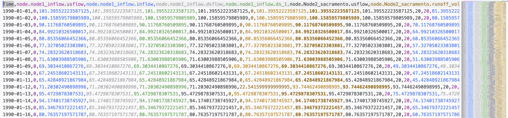

# [outputs]

Model outputs listed in the [outputs] section are recorded during the simulation, and available in the result window (KalixIDE) or written to file (Kalix CLI).

Refer to the node documentation ([Nodes](nodes.md)) to see the available outputs.

Values published by [`[var.*]` blocks](vars.md) are recordable the same way —
one bare line per series:

```ini
[outputs]
node.dam.volume
var.accounting.headroom
```

A handful of node/account properties are fixed for the whole run rather than
computed each step — see [Static Node Properties](referencing-model-results.md#static-node-properties)
and [`[acc.*]`](accounts.md#recordable-series). These are recordable the same
way too; the resulting series simply repeats the declared value at every
timestep.

### Output file format

The CSV format has a single header row, and a single timestamp column.

**Rows:** Column names are written in the top row, separated by commas.

**Columns:** Timestamps are written in the first column, and follow an ISO format. For daily (or longer) timesteps at midnight this reduces to “YYYY-MM-DD”; daily data at another time of day, such as 9am, keeps the time (e.g. “2020-01-01T09:00:00”). The column is headed “date” when its values are bare dates and “datetime” when they carry a time. Subsequent columns contain model results. These appear in the output CSV file in the same order that they are specified in the model file.



You can read the output file into a Pandas dataframe for postprocessing simply:

```python
  import pandas as pd
  df = pd.read_csv('blarg.csv', parse_dates=['Time'], index_col='Time')
```
