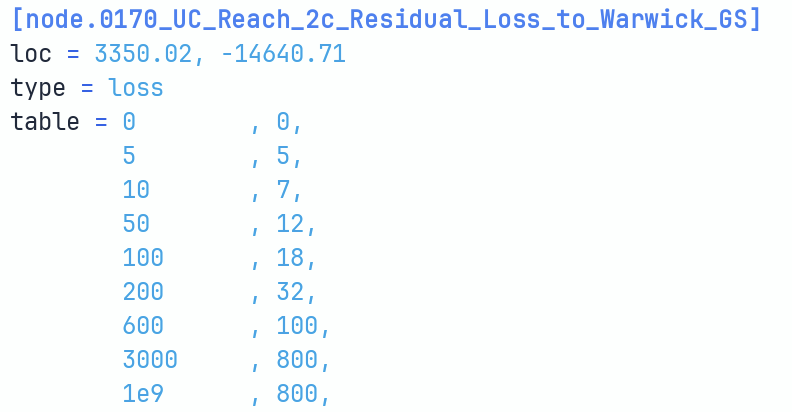

# Parameter types

[Table parameters](parameter-types.md)

## Table parameters

<figure markdown class="kx-figure--plain">

<figcaption>A table parameter: a loss node's table, one flow, loss pair per row.</figcaption>
</figure>
